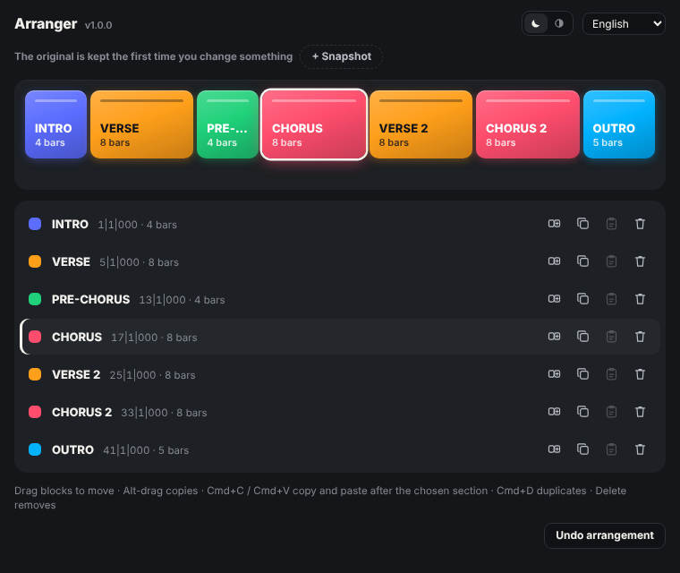
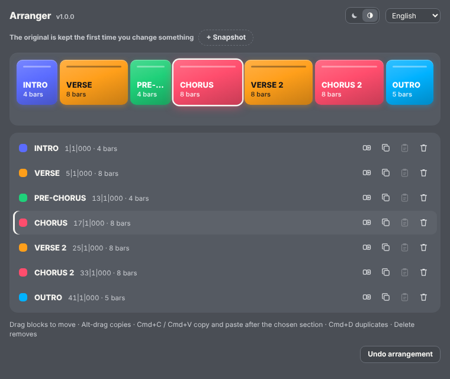

# Arranger for LUNA

Try different arrangements of a song without losing the original. The markers are the song's
sections (INTRO, VERSE, CHORUS…): drag a section to move it, Alt-drag to copy it, duplicate or
remove it, and the whole song follows, on every track at once. Arranger keeps the song as it was
as a protected **Original**, so you can compare versions with one click.

  
  

## Features

- **Sections from your markers.** Each section runs from its marker to the next; the last one
  runs to the end of the song. They show as coloured blocks sized by their length in bars.
- **Drag to move, Alt-drag to copy.** A line shows where the section will land; everything after
  it moves to make room or close the gap.
- **Duplicate, copy, paste and remove** from the block's right-click menu, the icons in the list,
  or the keyboard: Cmd+D duplicates, Cmd+C / Cmd+V copy and paste after the chosen section,
  Delete removes, ← → pick a section.
- **Every track at once:** audio, MIDI and automation move with their section. Copies get their
  own marker (VERSE 2, VERSE 3…).
- **Snapshots.** The first time you change something, the song is kept as **Original** and you
  work on a copy. Every snapshot is a playlist version on each track plus its markers, saved in
  the session. Click a snapshot to switch the whole song to it; **+ Snapshot** keeps the current
  state and goes on in a new copy; double-click to rename. The Original is never edited.
- **Undo arrangement** takes back what Arranger did since the last snapshot switch.
- **Vivid colours**, one per section name, kept as you rearrange; markers that already have a
  colour keep theirs.
- **Dark and grey themes.**
- **7 languages:** English, Español, Català, Français, Deutsch, Italiano and Português.

## How to use it

1. Put a marker at the start of each section of the song.
2. Open **Arranger**: the sections appear as blocks.
3. Drag, Alt-drag, duplicate or remove sections and listen.
4. Click **Original** to hear the song as it was, and back to your version to compare. Use
   **+ Snapshot** to keep an idea and try another.

Tempo and meter changes stay where they are; if your song has them inside a section, check them
after moving it.

## Support

If something does not work as expected, Alt-click the version number at the top of the window:
it copies a short report to paste in a message to fedetrillo@gmail.com.

## Install

Requires LUNA 3.1.2 or later. Install it from LUNA's Add On marketplace, or download
`arranger.lunaaddon` from the latest release and double-click it. Then open a session and choose
**Add Ons > Windows > Arranger**.

## En español

Prueba arreglos distintos de una canción sin perder el original. Las marcas son las secciones
(INTRO, VERSE, CHORUS…): arrastra una sección para moverla, Alt+arrastrar para copiarla,
duplícala o quítala, y toda la canción se recoloca en todas las pistas a la vez, con su audio,
MIDI y automatización. Arranger guarda la canción como estaba en una foto «Original» protegida
y te deja crear más fotos y cambiar entre ellas con un clic para comparar. Modo oscuro y gris,
7 idiomas.

## Licence

Copyright (c) 2026 Fede Trillo. All rights reserved. Free to install and use in LUNA; the code
may not be copied, modified or redistributed. See [LICENSE](LICENSE). The bundled LUNA Builder
SDK is Universal Audio's, under the Apache License 2.0: see
[THIRD_PARTY_NOTICES.md](THIRD_PARTY_NOTICES.md).

Contact: fedetrillo@gmail.com
